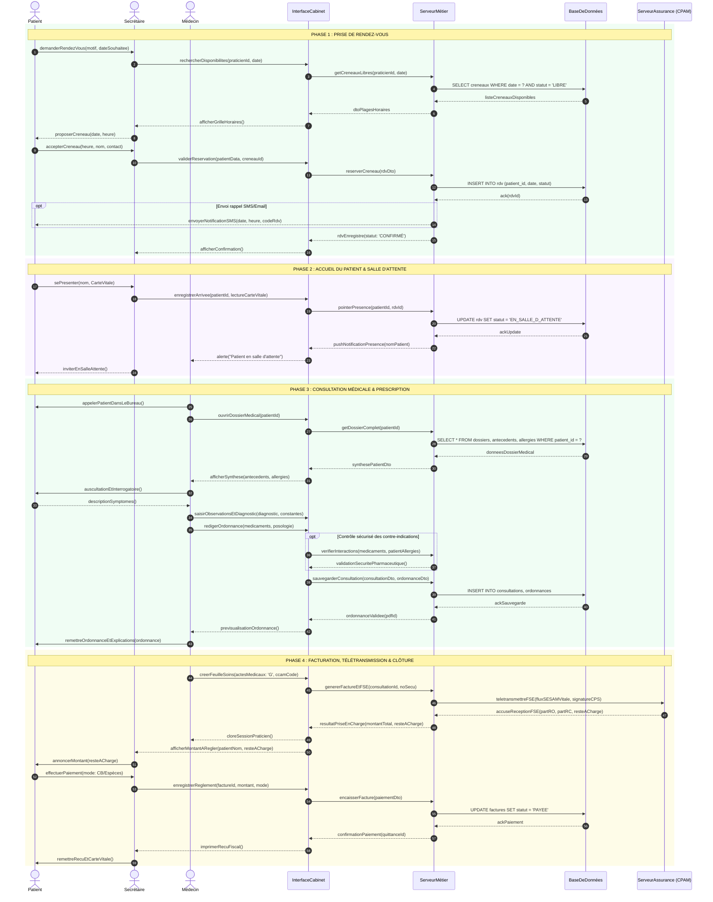

# Spécification & Diagramme de Séquence UML — Cabinet Médical

Ce document détaille la conception, la modélisation UML et l'implémentation du **Diagramme de Séquence** modélisant le cycle de vie complet d'une consultation au sein d'un cabinet médical.

Le fichier Draw.io prêt à l'emploi est disponible à l'emplacement :  
📂 [`medicin.dio`](file:///c:/Users/djebi/drawio/medicin.dio)

---

## 1. Modélisation & Réflexion Conceptuelle (Thinking)

### 1.1 Objectifs Métier
Un système d'information de cabinet médical doit répondre à des impératifs stricts :
1. **Fluidité du parcours patient** : De la réservation d'un créneau jusqu'à la sortie du cabinet.
2. **Sécurité médicale** : Historique des antécédents, alertes d'allergies et contrôle des contre-indications médicamenteuses lors de la prescription.
3. **Conformité médico-légale et administrative** : Conservation du dossier médical, télétransmission de la Feuille de Soins Électronique (**FSE**) via **SESAM-Vitale** et encaissement.

---

### 1.2 Lignes de Vie (Participants / Lifelines)

| Rôle / Entité | Type | Description |
| :--- | :--- | :--- |
| **`p: Patient`** | Acteur externe | Le patient sollicitant un rendez-vous, se présentant au cabinet et recevant les soins. |
| **`sec: Secrétaire`** | Acteur humain | Gère les plannings, accueille le patient, lit la carte Vitale et encaisse le règlement. |
| **`med: Médecin`** | Acteur praticien | Ausculte, consulte le dossier médical, pose le diagnostic et rédige l'ordonnance. |
| **`ui: InterfaceCabinet`** | Système (Front-end) | Interface utilisateur (web ou logiciel lourd) connectée aux lecteurs SESAM-Vitale. |
| **`srv: ServeurMétier`** | Système (Back-end) | Contrôleur applicatif appliquant les règles métier, validations et orchestration des flux. |
| **`db: BaseDeDonnées`** | Persistance (DMI) | Système de gestion de base de données hébergeant les dossiers patients, agendas et factures. |
| **`ext: ServeurAssurance`** | Système externe | Télétransmission CPAM / Mutuelles pour la prise en charge et le tiers-payant. |

---

## 2. Diagramme de Séquence Mermaid

---

## 3. Détail des 4 Phases

### Phase 1 : Prise de Rendez-vous
- Vérification des plages disponibles en base selon l'agenda du médecin.
- Évitement des doublons et des collisions de créneaux.
- Bloc `opt` pour l'envoi asynchrone d'une confirmation par SMS/e-mail avec rappel 24h avant.

### Phase 2 : Accueil & Salle d'attente
- Lecture de la carte Vitale par la secrétaire pour identifier l'assuré et mettre à jour ses coordonnées.
- Notification instantanée de l'arrivée du patient sur l'écran du praticien.

### Phase 3 : Consultation Médicale & Prescription
- Consultation immédiate des antécédents, allergies et traitements en cours.
- Examen clinique et saisie des constantes (tension, rythme cardiaque, poids).
- Bloc `opt` d'aide à la décision thérapeutique : vérification automatique des interactions médicamenteuses et contre-indications.

### Phase 4 : Facturation, Télétransmission & Sortie
- Cotation de l'acte (ex: consultation de médecine générale `G`, cotation CCAM).
- Télétransmission SESAM-Vitale signée par la Carte de Professionnel de Santé (CPS).
- Calcul instantané du Tiers-Payant (Part Caisse Primaire d'Assurance Maladie + Part Complémentaire/Mutuelle) et du reste à charge patient.
- Encaissement et remise de la quittance.
